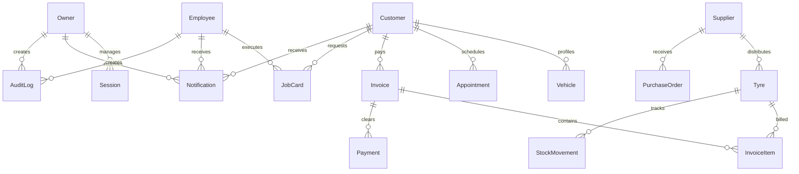

# Taj Tyre Works - Database Architecture & Schema Design

This document details the relational schema layout, model relationships, and index configurations designed using **Prisma ORM** for **Neon PostgreSQL**.

---

## 1. Entity-Relationship Diagram (ERD)

The database schema is organized around the following key functional entities:

---

## 2. Core Database Tables & Models

### 2.1. Owner
Stores workshop owner accounts.
- `id` (String UUID, Primary Key)
- `name` (String)
- `username` (String, Unique Index)
- `password` (String, bcrypt hash)

### 2.2. Customer
Manages customer profiles, visits, and totals.
- `id` (String UUID, Primary Key)
- `name` (String)
- `phone` (String, Unique Index)
- `visits` (Integer)
- `totalSpent` (Float)
- `rewardPoints` (Integer)
- `address` (String, nullable)

### 2.3. Vehicle
Profiles customer cars/bikes.
- `id` (String UUID, Primary Key)
- `brand` (String)
- `model` (String)
- `year` (Integer)
- `fuelType` (VehicleFuelType Enum)
- `plateNumber` (String, Unique Index)
- `customerId` (String UUID, Foreign Key -> Customer)

### 2.4. Tyre / Product
Handles stock details and CMS categories.
- `id` (String UUID, Primary Key)
- `brand` (String)
- `name` (String)
- `category` (TyreCategory Enum)
- `size` (String)
- `sellingPrice` (Float)
- `quantity` (Integer)
- `location` (String)
- `barcode` (String, Unique Index)
- `description` (String, nullable)
- `warranty` (String, nullable)
- `imageUrl` (String, nullable)
- `supplierId` (String UUID, Foreign Key -> Supplier)

### 2.5. Invoice
Handles checkouts and total GST calculations.
- `id` (String UUID, Primary Key)
- `invoiceNumber` (String, Unique Index)
- `subTotal` (Float)
- `gstAmount` (Float)
- `netTotal` (Float)
- `customerId` (String UUID, Foreign Key -> Customer)

---

## 3. Database Indexes & Constraints
- **Unique Indexes**: Implemented on `phone` (Customer), `username` (Owner/Employee), `barcode` (Tyre), `plateNumber` (Vehicle), and `invoiceNumber` (Invoice).
- **Cascade Deletes**: Configured on foreign keys so that removing a parent record (e.g. deleting a Customer) safely cascades to dependent logs (e.g. deleting vehicles/appointments) without leaving orphaned entries.
